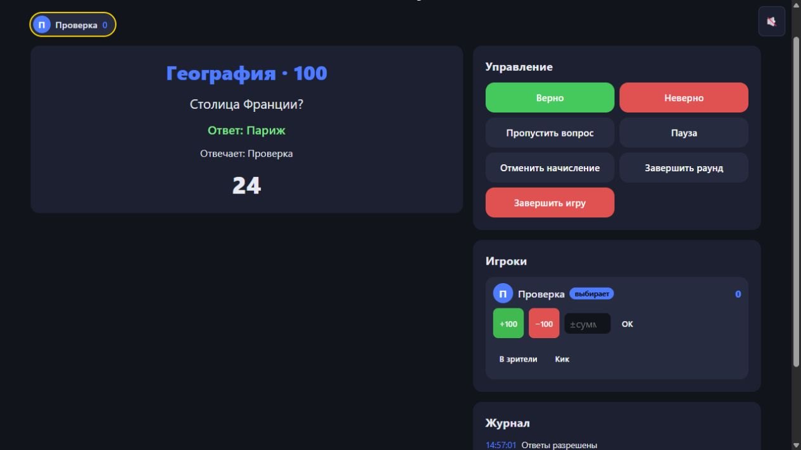

# Исправления после аудита — 13.11.2026

Исправлены все 13 групп причин A1–A13 из исходного [аудита](QA_REPORT_2026-11-13.md), а также размещение панели реакций и видимость правильного ответа на пульте во время судейства. Дизайн и прочие предложения из аудита остаются отдельным будущим этапом.

## Что изменено

| Группа | Исправление |
|---|---|
| A1 | Финал доступен после последнего верного ответа, закрытия/пропуска вопроса и завершения раунда из любой обычной игровой фазы. Допустимость следующей фазы проверяется до изменения поля/индекса. |
| A2 | Перед запуском проверяется наличие подключённого игрока, не зрителя. Отказ сохраняет lobby и game=null. |
| A3 | Undo ручного счёта изменяет только счёт, не отменяя игровые таймеры и паузу. |
| A4–A6 | Удаление или перевод в зрители исключает участника из текущих ставок. Аукцион без оставшихся ставок закрывается; зритель не может выиграть аукцион. Кик участника финала больше не приводит к TypeError. |
| A7 | Финальный вердикт имеет отдельный тип истории finalVerdict: undo возвращает счёт и удаляет вердикт, после чего можно вынести исправленный. |
| A8 | Вердикт содержит questionId, answerAttemptId и playerId. Старые, повторные и бесконтекстные запросы отклоняются до изменения таймеров/очков. На пульте кнопки блокируются до ack. |
| A9–A10 | session.js централизует снятие всех прежних подписок при выходе/смене комнаты. Кик и смена роли применяются ко всем вкладкам профиля; отключение одной вкладки не отключает профиль, пока есть другие. |
| A11 | Ставки, цена кота и ручная дельта проверяются как безопасные целые числа; "100xyz", дроби и некорректные типы не принимаются. correct должен быть boolean. |
| A12 | Mute переключает localStorage и иконку; изменение синхронизируется между вкладками. |
| A13 | dragstart/dragend не всплывают в родительские draggable-блоки. ID перетаскиваемого вопроса не заменяется ID раунда. |

Дополнительно:

- У reaction-bar указан класс, соответствующий фиксированному нижнему блоку CSS.
- Правильный ответ постоянно виден ведущему во время вопроса, включая answer.
- Undo последнего обычного вердикта разрешён после входа в финал, пока никто не сделал ставку. Повторный ответ снова корректно запускает финал.
- Таймер ответа связан с ID попытки; старый отложенный callback не судит новую попытку.
- Старым сохранённым текущим вопросам/попыткам присваиваются недостающие ID. При undo старой записи вопрос получает ID, если его ещё нет.
- История удалённого участника не восстанавливает отсутствующего отвечающего; при переводе в зрители сохраняются только ручные корректировки этого участника.

## Результаты проверки

Все проверки выполнены на отдельных localhost-стендах с временными БД. Пользовательские комнаты и серверы не изменялись.

| Набор | Пройдено | Ошибок |
|---|---:|---:|
| e2e | 29 | 0 |
| late-judge | 6 | 0 |
| game | 63 | 0 |
| host | 32 | 0 |
| media | 22 | 0 |
| packs | 34 | 0 |
| special | 33 | 0 |
| final-resume | 18 | 0 |
| stability на localhost | 30 | 0 |
| edge-audit, расширенный | 26 | 0 |
| ui-audit | 2 | 0 |
| Всего | 295 | 0 |

Проверен синтаксис 42 JS/MJS-файлов и отсутствие ошибок whitespace в diff. Проверка занятого порта также прошла.

Новые негативные сценарии не ослаблены: старые ID попытки и отсутствие ID отклоняются; после undo того же игрока нельзя судить ID его предыдущей попытки. Тестовый клиент socket-client.mjs получает актуальные ID только из публичных событий/снимков и не перезаписывает явно переданные поля негативных запросов. Это обновление тестов под обязательный протокол вердиктов, а не отключение проверки ошибок.

В браузере проверены:

- Переключение 🔊 → 🔇 и сохранение mute при открытии страницы игрока.
- Создание комнаты, вход игрока, запуск и открытие вопроса.
- Открытие кнопки, нажатие, вердикт +100 по новому протоколу.
- Сохранение правильного ответа на пульте во время ответа.
- Обновление пульта, undo и смена решения на «Неверно» с итоговым счётом −100.
- У reaction-bar вычисленный CSS position=fixed.



Реальный жест drag-and-drop проверялся выполнением настоящих обработчиков с моделью всплытия в VM, не жестом мыши. Реальные iOS/Android, вибрация и слышимость медиа требуют отдельного прогона на устройствах. Настоящий nginx в этом исправлении повторно не запускался: изменения проверены на localhost; его конфигурация не менялась.

## После обновления

Перезапустите свой сервер и обновите страницы ведущего и игроков. Старые открытые страницы ведущего не передают обязательный контекст попытки и будут получать ошибку устаревшего вердикта.

Команды дополнительных регрессий:

```sh
node test/edge-audit.mjs
node test/ui-audit.mjs
node test/stability.mjs
```

edge-audit и stability сами создают отдельный сервер и временную БД. Остальные исторические сценарии запускаются по инструкции README в отдельной тестовой копии проекта.
