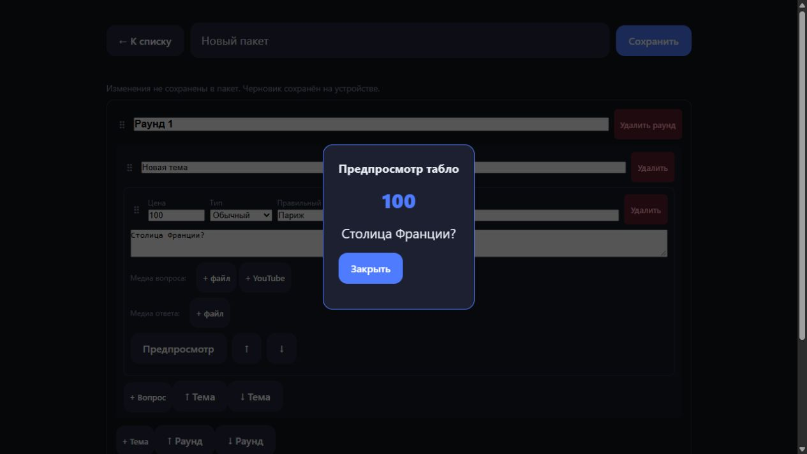

# Улучшения интерфейса и работы с пакетами

## Игровые экраны

- Пульт ведущего: закреплённая панель на широком экране, отдельный сворачиваемый блок завершения игры, контекстные основные кнопки.
- Горячие клавиши: пробел открывает кнопку, V/X — вердикт, P — пауза. В полях ввода и при удержании клавиши команды не срабатывают.
- Undo недоступен при пустой истории и подписывает конкретное отменяемое действие. Ручные значения корректировки сохраняются по ID игрока при обновлении списка.
- Экспорт журнала в текстовый файл, индикатор соединения и проверка задержки по кнопке. Раздельные регуляторы эффектов и медиа сохраняются локально.
- Полноэкранный режим и переключатель крупного текста Aa. Выбор крупного текста сохраняется локально.
- Табло: адаптивная крупная типографика, ограничение ширины строки, выделение отвечающего. На экране игрока состояния выделены рамками, у таймера есть полоса остатка времени.
- Учитывается prefers-reduced-motion; добавлен видимый фокус клавиатуры.

## Редактор

- Локальный черновик раз в секунду, восстановление по кнопке и предупреждение о несохранённых изменениях. Черновик хранится в браузере, не заменяет сохранение пакета в SQLite и не переносится на другой ПК через Git.
- Предпросмотр вопроса с медиа в модальном окне; правильный ответ в просмотр табло не попадает.
- Кнопки ↑/↓ для раундов, тем и вопросов в дополнение к перетаскиванию.
- Прогресс загрузки и отмена файла; существующие превью медиа сохраняются.
- Закреплённая панель сохранения и явный статус сохранения.



## Медиа и производительность

- Каталог пакетов читается одним SQL-запросом вместо дополнительного запроса на каждый пакет.
- Предзагрузка ограничена тремя изображениями одновременно и не повторяется для уже запрошенных URL. Аудио/видео загружаются при показе вопроса, чтобы не скачивать все крупные файлы раунда на телефоны.
- Управление аудио/видео передаёт позицию при play/pause/seek. Игроки тоже принимают команды ведущего. Последняя команда сохраняется в состоянии комнаты и применяется после переподключения. При продолжающемся воспроизведении учитывается прошедшее с команды время; точность зависит от часов устройств и браузерного autoplay. Для YouTube используются прежние iframe, позиционное управление к ним не применяется.
- У полей и списков ручного счёта убраны лишние перестроения при неизменившемся составе/счёте/фазе.
- Очистка пишет структурированный итог без токенов; запись снимков дольше 100 мс отмечается событием slow_snapshot.

## Проверки

В браузере проверены создание пакета, сохранение локального черновика, предпросмотр и успешное сохранение. Громкость, вибрация, реальные телефоны и синхронность медиа на разных устройствах требуют отдельной проверки на оборудовании.

Единый безопасный запуск:

```sh
node scripts/test-all.mjs
```

Команда копирует только исходный код, тесты и зависимости во временную папку, создаёт новую БД и свободный localhost-порт, запускает последовательно регрессию и сама останавливает свой сервер. Рабочий data/ не копируется. Путь стенда печатается в конце; временная папка остаётся для диагностики.

К 295 прежним проверкам добавлены 5 проверок очереди предзагрузки, дедупликации и позиционного управления медиа. Итоговый прогон должен завершаться с кодом 0.

## Следующие самостоятельные задачи

Этот набор реализует прикладные улучшения без смены стека. Отдельными работами остаются: полноценная новая графическая тема с макетами, покомпонентное обновление всех игровых полей, расширенная история диагностики и нагрузочный прогон на сотнях комнат. Предложения из исходного аудита не означают, что эти работы уже выполнены.
