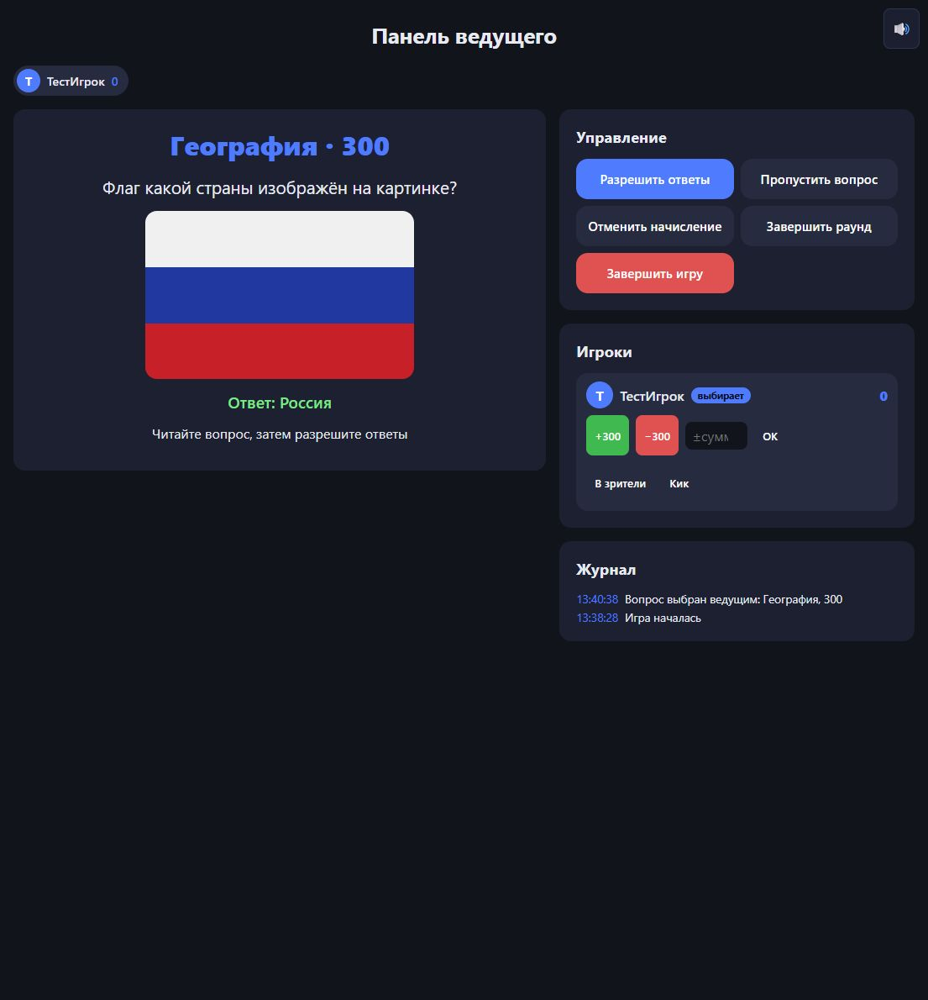

# Аудит SIGame — 13.11.2026

**Статус: описанные ниже дефекты исправлены.** Это исторический отчёт исходного аудита; актуальные результаты находятся в [отчёте об исправлениях](FIXES_2026-11-13.md).

Проверена версия `ebe3a6f`. Аудит выполнялся на отдельных localhost-портах, временных SQLite и тестовых медиа. Рабочие комнаты и процессы пользователя не изменялись. Код приложения не исправлялся: добавлены диагностические тесты и этот отчёт.

## Результат

Имеющаяся регрессия зелёная, но углублённые сценарии выявили существенные дефекты. До их исправления нельзя считать финальный раунд, undo и изменение состава участников полностью надёжными.

| Набор | Успешно | Неуспешно |
|---|---:|---:|
| e2e | 29 | 0 |
| late-judge | 6 | 0 |
| game | 63 | 0 |
| host | 32 | 0 |
| media | 22 | 0 |
| packs | 34 | 0 |
| special | 33 | 0 |
| final-resume | 18 | 0 |
| stability без nginx | 30 | 0 |
| Новый edge-audit | 3 | 15 |
| Новый ui-audit | 0 | 2 |
| Всего | 270 | 17 |

17 неуспешных проверок соответствуют 13 группам дефектов: часть сценариев воспроизводит одну причину разными путями. Отдельно проверена обработка EADDRINUSE: понятная ошибка, завершение с кодом 1. Сбой процесса во время негативных запросов не обнаружен.

## Воспроизведённые дефекты

Приоритет P1 означает риск остановки игры, неверного счёта или смешивания комнат; P2 — функциональная ошибка без полной остановки игры. Это приоритеты данного проекта, не оценка внешней уязвимости.

| ID | Приоритет | Сценарий и фактический результат | Причина/точка исправления |
|---|---|---|---|
| A1 | P1 | Пакет с одним обычным вопросом и финалом. Верный ответ на последний вопрос, закрытие сгоревшего, пропуск или завершение раунда из question дают «Недопустимый переход … → final». Индекс раунда уже сдвинут, состояние частично изменено. | `server/game.js`, ALLOWED и startFinal/advance/endRound. Разрешён только board → final; отсутствуют другие необходимые переходы. Проверять возможность перехода до мутаций. |
| A2 | P1 | Единственного игрока перевести в зрители и нажать «Начать игру»: TypeError reading id; комната остаётся board с game=null. | `startGame` меняет фазу до проверки пула; сокет проверяет общее количество участников, включая зрителей. |
| A3 | P1 | Во время buzz или answer вручную изменить очки и сразу undo. После 5/3 секунд соответственно таймер не срабатывает; фаза зависает. | `undo` вызывает clearAllTimers для любого типа истории; таймеры восстанавливаются только для verdict, не adjust. |
| A4 | P1 | В аукционе игрок сделал ставку, ведущий его кикнул, затем закрыл приём. Ошибка reading nick, аукцион остаётся незакрытым. | `auctionClose` не исключает ставки удалённых участников. |
| A5 | P1 | В аукционе ставившего перевести в зрители и закрыть ставки. Зритель становится отвечающим. | Перед выбором победителя не проверяется актуальная роль. Нужна единая политика для отключённых/удалённых/переведённых участников. |
| A6 | P1 | Участник финала сделал ставку; после закрытия ответов его кикнули. Вердикт приводит к reading score. | `finalJudge` предполагает наличие player; финальные bets/answers не согласуются с удалением участника. |
| A7 | P1 | Вынести финальный вердикт, undo, затем исправить вердикт. Очки откатились, но verdict остался; повторный вердикт запрещён как уже вынесенный. | Финальный вердикт сохраняется в истории как adjust; откатывается только score, не final.verdicts. |
| A8 | P1 | Первый игрок ответил неверно, кнопку нажал второй; прислать запоздалый вердикт с ID первого. Сервер игнорирует ID и начисляет очки второму. | Протокол answer:judge не привязан к questionId/answerAttemptId/отвечающему; старый запрос применяется к текущей попытке. Существующий late-judge ловит другую ситуацию, когда нового отвечающего ещё нет. |
| A9 | P1 | Игрока перевести в зрители, он выходит через player:leave; затем ведущий открывает вопрос при скрытии текста от игроков. Вышедший сокет всё ещё получает полный текст. | Выход оставляет подписку `${roomId}:full`. |
| A10 | P1 | Сокет игрока входит в другую комнату без разрыва соединения. Он продолжает получать события прежней комнаты. | room:join/session:resume добавляют подписки, не снимая предыдущие; нужна централизованная смена сессии. |
| A11 | P2 | Отправить auction:bet с amount="100xyz": ставка принята как 100. | parseInt вместо строгой проверки конечного целого числа. Проверить также остальные цены/дельты/ставки и тип correct. |
| A12 | P2 | Нажать 🔊. Иконка остаётся 🔊, localStorage mute не меняется. | `client/shared/sounds.js`: обработчик вызывает sync, но не toggleMute. Проверено в браузере и выполнением настоящего обработчика в VM. |
| A13 | P2 | Dragstart вопроса всплывает в тему и раунд: в dataTransfer вместо q0:0:0 остаётся r0. Перенос вопроса не распознаётся обработчиком drop. | `client/packs/packs.js`: родительские dragstart повторно записывают ID. Проверено исполнением настоящих обработчиков с моделью всплытия; реальный жест мышью в браузере не проверен. |

Дополнительный визуальный дефект: у контейнера `id="reaction-bar"` нет класса `.reaction-bar`, под который написаны стили. На странице игрока реакции отображаются в обычном потоке, без предусмотренного фиксированного блока снизу. Это подтверждается HTML/CSS и наблюдаемым desktop-экраном.

Ведущему правильный ответ показывается перед открытием кнопки и в reveal, но скрывается во время answer. Это затрудняет судейство; стоит оставлять ответ видимым только на пульте ведущего на протяжении всего вопроса.

## Что проверено в реальном браузере

На изолированном localhost-стенде:

- Создание комнаты с выбранным пакетом, корректная ссылка из PUBLIC_URL.
- Вход игрока, обновление ведущего и игрока без потери сессии.
- Запуск, поле у ведущего/игрока/табло, недоступность сыгранной ячейки.
- Открытие вопроса с изображением: текст/картинка есть на табло и пульте, скрыты от игрока при соответствующей настройке.
- «Разрешить ответы», появление большой кнопки, нажатие, определение отвечающего, вердикт +300, обновление счёта.
- Редактор: создание пустого пакета, ошибки обязательных полей, заполнение и успешное сохранение.
- Неработающий mute; компоновка пульта и панели реакций.

Скриншот пульта:



Ограничения ручного прогона: браузерная автоматизация зависла на нативном confirm «Завершить раунд», поэтому оставшаяся последовательность специальных вопросов проверена автотестами, а не полностью вручную в этом браузере. Это ограничение стенда, не доказательство дефекта приложения. Попытка установить viewport 375×812 не изменила фактическую ширину страницы (осталась 1280), поэтому мобильный визуальный прогон не засчитан. Реальные iOS/Android, вибрация, слышимость аудио, внешние YouTube и TLS в этом прогоне не проверялись. HTTP-загрузка медиа, ограничения размеров и события синхронизации покрыты существующими тестами; они не заменяют прослушивание/просмотр на телефоне.

## Производительность

Замеры на одном ПК, localhost, WebSocket, маленькие встроенные пакеты; это не нагрузочный SLA и не модель мобильного интернета.

- 50 подключённых клиентов одновременно нажимают: ровно 1 принятый ответ; все ack получены за 5,86 мс (в предыдущем повторе 7,34 мс).
- 150 последовательных session:resume: p50 0,19 мс, p95 0,25 мс, максимум 0,46 мс.
- После негативных сценариев сервер отвечает на healthcheck.

Долгую нагрузку на сотни комнат, большие видео, объёмную SQLite, утечки памяти в течение нескольких часов и задержки/потери реальной сети этот прогон не моделирует.

## Предложения по улучшению

### 1. Сначала целостность игры

- Исправить A1–A10 и включить сценарии в обязательную регрессию. Переход фазы должен быть атомарным: сначала полная проверка, затем изменение состояния.
- Добавить questionId, answerAttemptId и requestId. Вердикт должен содержать ожидаемую попытку; повторные и запоздалые команды не должны менять новую попытку.
- Разделить историю adjust/normalVerdict/finalVerdict и откатывать целиком связанное состояние. Undo ручного счёта не должен трогать таймеры.
- Централизовать вход/выход/смену роли и очистку ставок; определить поведение нескольких вкладок одного игрока и ведущего.
- Для финала без участников показать понятное действие «Завершить игру». Добавить явные состояния «ставка принята», «ответ отправлен», счётчик готовности, возможность исправить вердикт.
- Создать одну безопасную команду полного тестового прогона с отдельным DATA_DIR и свободным портом. Старые тесты пока требуют отдельной копии и имеют жёсткие адреса/пути.

### 2. Пульт ведущего

- Сделать контекстное главное действие самым заметным: открыть кнопку → вынести вердикт → показать ответ → следующий вопрос. Опасные «Завершить раунд/игру» убрать в отдельный блок или меню.
- Закрепить панель управления при прокрутке; постоянно показывать отвечающего, стоимость, таймер и правильный ответ. Ручной счёт и журнал сделать компактнее/сворачиваемыми.
- Перед undo показывать название отменяемого действия и блокировать кнопку при пустой истории.
- Добавить горячие клавиши с подсказками и защитой от срабатывания в полях ввода; повторные клики блокировать до ack.
- Отображать состояние соединения и причину недоступной кнопки; при отключении ведущего игрокам показывать понятный статус.

### 3. Игрок и табло

- У игрока выделить четыре хорошо различимых состояния: ожидание, можно нажать, отвечаешь, заблокирован. Использовать не только цвет, но текст/иконку; показать ход таймера визуально.
- Исправить mute и размещение реакций. Разделить громкость эффектов и медиа; для тестов на одном ПК предусмотреть режим без дублирования звука из нескольких вкладок.
- Для табло — крупный адаптивный текст вопроса, ограничение длины строки, устойчивое место счёта, заметное объявление победителя нажатия, полноэкранный режим и экран итогов с победителем.
- Добавить умеренные переходы между вопросом/полем и анимацию изменения очков, учитывать prefers-reduced-motion. Умеренность важнее сложной графики, особенно на старых телефонах.
- Для темы оформления предложить два варианта: текущая компактная тёмная и «телевизионное табло» с крупной типографикой и высоким контрастом. Иллюстрации/логотип не должны уменьшать игровое поле.
- Обязательно повторить визуальный QA при 360/375/390 px на реальных мобильных браузерах, с длинными темами и 8–12 игроками.

### 4. Редактор

- Исправить всплытие dragstart; предусмотреть кнопки ↑/↓ для клавиатуры и телефонов.
- Предупреждать о несохранённых изменениях, добавить черновик/autosave и явный статус сохранения.
- Сделать предварительный просмотр вопроса глазами игрока/табло и кнопку «Проверить пакет» с переходами к ошибкам.
- Визуально группировать раунд → тему → вопрос, сворачивать крупные блоки, выделить финал. Добавить прогресс и отмену загрузки, превью медиа и пояснение ограничений.

### 5. Производительность и эксплуатация

Это предложения по коду, а не обнаруженные измерением тормоза:

- `listPacks` делает дополнительный SELECT и JSON.parse полного пакета для каждой строки. Хранить статистику отдельно или получать данные одним запросом; особенно важно при большом каталоге.
- Предзагрузка сейчас делает fetch для всех не-графических файлов раунда без лимита параллелизма. Ввести ограниченную очередь, учитывать размер/тип, не загружать все 100-МБ видео заранее на телефоны.
- Не пересоздавать весь список игроков и поле при каждом событии; обновлять изменившиеся узлы. Это также сохранит фокус в ручной корректировке счёта и черновики ввода.
- Сохранять по изменениям и проверять стоимость полного периодического flush при росте числа комнат. Добавить метрики времени snapshot, размера БД и длительности очистки.
- Синхронизацию медиа расширить серверной временной отметкой, позицией воспроизведения и seek: нынешние play/pause не гарантируют одинаковую позицию после переподключения.
- Добавить структурированные логи с roomId/requestId/phase, не записывая токены; экран диагностики подключения и экспорт журнала игры.
- Для ограничения неоднозначного localhost проверять запуск второго процесса и явно показывать адрес сервера/экземпляр. Несколько процессов с разными bind IPv4/IPv6 могут отвечать разными комнатами.

## Порядок следующей работы

1. Отдельный этап исправления целостности: A1–A10 с тестами, затем A11–A13 и панель реакций.
2. Обновить общий тестовый запуск и повторить тот же аудит: диагностические FAIL должны стать PASS.
3. Отдельный этап UX ведущего и редактора; сначала подтвердить сценарии и макет.
4. Реальные телефоны + проектор, медиа и сеть; затем оптимизировать только измеренные узкие места.

Повторный запуск новых проверок:

```sh
node test/edge-audit.mjs
node test/ui-audit.mjs
```

edge-audit самостоятельно запускает отдельный сервер и временную БД. AUDIT_OUTPUT позволяет выбрать путь JSON-отчёта. ui-audit исполняет реальные UI-обработчики в VM с минимальной моделью DOM-событий. Пока дефекты не исправлены, оба сценария намеренно завершаются с кодом 1; это не зелёная регрессия. Результаты этого документа относятся к проверенной версии и должны обновляться после исправлений.
